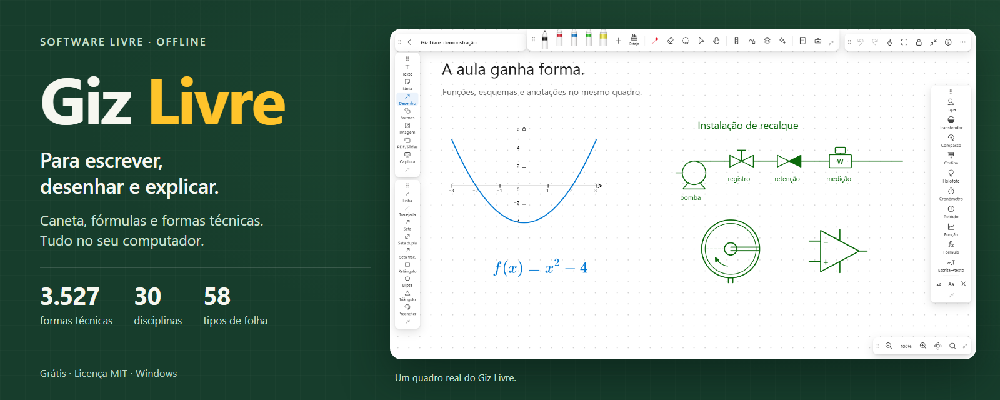
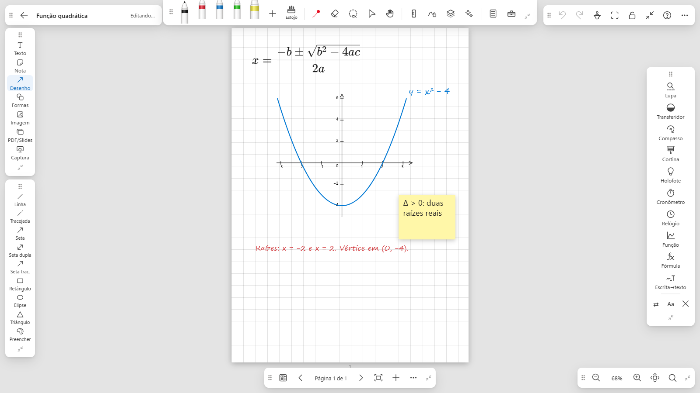
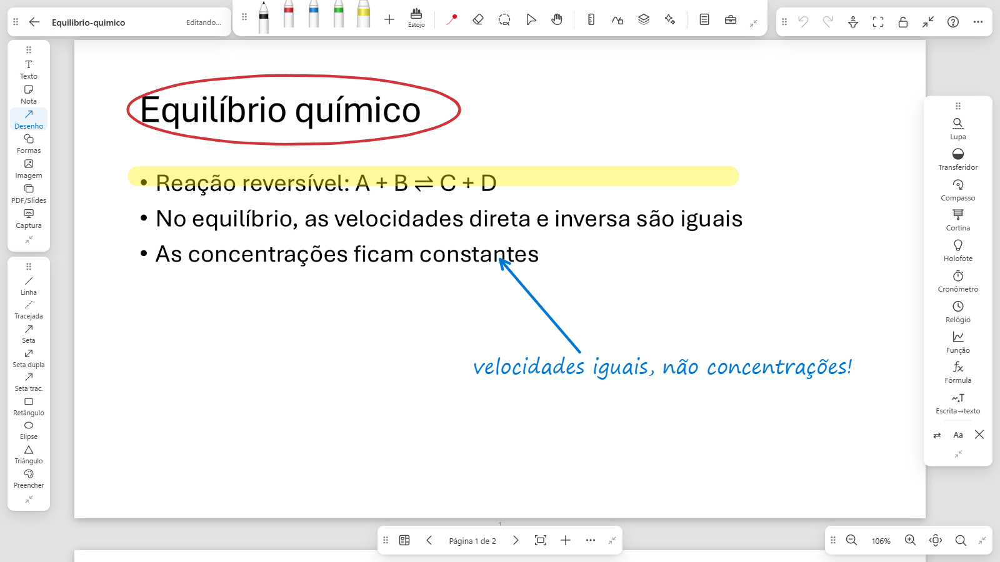
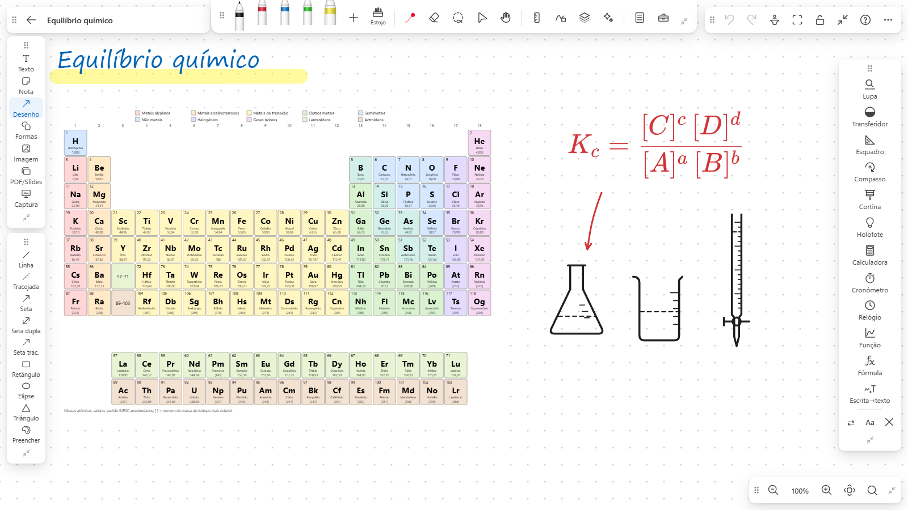
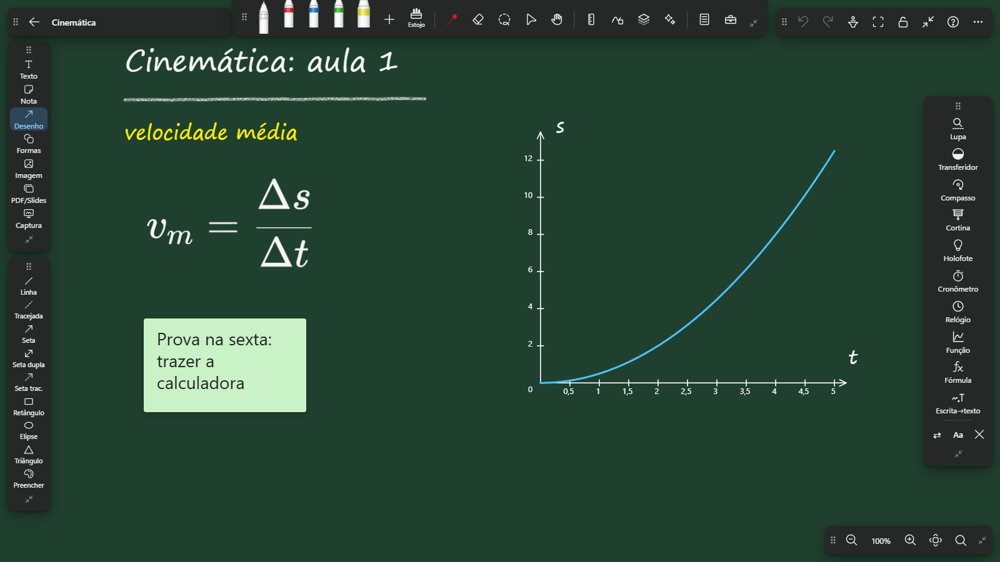

<p align="center"></p>

<h1 align="center">Giz Livre </h1>

<p align="center"><b>Lousa digital livre e offline para dar aula com mesa digitalizadora, caneta, toque ou mouse.</b><br>
Feita por um professor para as próprias aulas: quadro infinito, caderno A4, slides do PowerPoint com escrita por cima,
folhas técnicas, fórmulas e ferramentas de professor. Livre, gratuita e sem internet.</p>

<p align="center">
  
  <a href="#sistemas"></a>
  
  <a href="LICENSE"></a>
  
  <a href="docs/GUIA-DE-USO.md#6-agentes-de-ia-experimental"></a>
  <br>
  <a href="https://github.com/HeraldoAntunes/giz-livre/actions/workflows/testes.yml"></a>
  <a href="https://scorecard.dev/viewer/?uri=github.com/HeraldoAntunes/giz-livre"></a>
  <a href="https://github.com/HeraldoAntunes/giz-livre/releases/latest"></a>
  <a href="https://github.com/HeraldoAntunes/giz-livre/releases"></a>
  <a href="https://doi.org/10.5281/zenodo.23552115"></a>
</p>

<p align="center">
  <a href="https://github.com/HeraldoAntunes/giz-livre/releases/latest"><b>⬇ Baixar o Giz Livre</b></a>
  &nbsp;·&nbsp; <a href="docs/GUIA-DE-USO.md">Guia de uso</a>
  &nbsp;·&nbsp; <a href="#programas-livres-">Programas Livres</a>
</p>

<p align="center"></p>

<p align="center">
  <a href="#qual-arquivo-baixar">Baixar</a> · <a href="#recursos">Recursos</a> · <a href="#sistemas">Sistemas</a> ·
  <a href="#atalhos-de-teclado">Atalhos</a> · <a href="#perguntas-frequentes">Perguntas</a> ·
  <a href="#programas-livres-">Programas Livres</a>
</p>

### Qual arquivo baixar?

Versão atual: **1.16.1**.

| Para quê | Baixar |
|---|---|
| **Instalar no computador (Windows)** | [**Instalar-GizLivre-1.16.1.zip**](https://github.com/HeraldoAntunes/giz-livre/releases/download/v1.16.1/Instalar-GizLivre-1.16.1.zip) |
| Usar sem instalar (versão portátil, para pendrive) | [GizLivre-1.16.1-portatil.zip](https://github.com/HeraldoAntunes/giz-livre/releases/download/v1.16.1/GizLivre-1.16.1-portatil.zip) |

Para instalar: extraia o zip inteiro (botão direito, "Extrair tudo") e abra o `GizLivre.exe` da pasta. Ele pergunta
se instala, copia a pasta para a sua conta, sem pedir administrador, e cria os atalhos. Os quadros e ajustes
continuam.

> Quem está na 1.15 ou antes: atualize à mão uma vez, com o zip acima. O Sobre dessas versões só sabe baixar o
> instalador antigo. Da 1.16.0 em diante, o Sobre atualiza sozinho de novo.

Se o Windows avisar "o Windows protegeu o computador", clique em **Mais informações → Executar assim mesmo** (o
programa é gratuito e não tem assinatura paga). Versões anteriores e a conferência dos arquivos ficam na
[página de versões](https://github.com/HeraldoAntunes/giz-livre/releases).

- **Grátis e livre:** licença [MIT](LICENSE). Use, copie e distribua à vontade, inclusive em escolas e redes de ensino.
- **Sem internet, sem conta, sem anúncios:** os quadros ficam só no seu computador.
- **Versão atual:** a da página de [Releases](https://github.com/HeraldoAntunes/giz-livre/releases/latest); o que mudou
  em cada versão está nas [novidades](CHANGELOG.md).

> **Aviso:** projeto independente e voluntário, fornecido "no estado em que se encontra", **sem garantia de qualquer
> tipo**. Faça backup dos seus quadros. As marcas citadas pertencem aos seus donos; o Giz Livre é um projeto independente, sem vínculo com elas.

## Como baixar e instalar (Windows)

As instruções abaixo descrevem a 1.16.0, com janela própria. A tabela de downloads acima permanece na última versão
publicada; os links da versão nova serão atualizados quando ela for publicada.

1. Abra a página de **[downloads (Releases)](https://github.com/HeraldoAntunes/giz-livre/releases/latest)**.
2. Baixe o arquivo que serve para você:

   | Arquivo | Para quem |
   |---|---|
   | **`Instalar-GizLivre-x.y.z.zip`** ⭐ | **quase todo mundo.** Extraia o zip inteiro e abra o `GizLivre.exe` da pasta: ele pergunta se instala, cria os atalhos e não pede senha de administrador |
   | `GizLivre-x.y.z-portatil.zip` | quem quer levar num pendrive sem instalar: descompacte e abra `GizLivre.exe` |
   | Código-fonte | só para quem vai estudar ou modificar o programa |

3. Depois de instalar, abra pelo atalho **Giz Livre** na Área de Trabalho ou no Menu Iniciar. O Python necessário
   já vem no pacote; não é preciso instalar Python nem ter Edge ou Chrome. A janela usa o WebView2 do Windows.
   Se o componente faltar, o programa orienta instalar o WebView2 oficial da Microsoft.

O Windows pode avisar "editor desconhecido" (SmartScreen), porque o programa não tem assinatura digital paga. Clique em
*Mais informações → Executar assim mesmo*. Para conferir se o arquivo é legítimo, compare o SHA-256 com o
`SHA256SUMS.txt` da mesma página (troque `x.y.z` pela versão que baixou):
```bash
certutil -hashfile Instalar-GizLivre-x.y.z.zip SHA256
```

**Pelo winget** (gerenciador de pacotes do Windows), para quem prefere instalar pela linha de comando:
```bash
winget install HeraldoAntunes.GizLivre
```
O pacote está em análise no catálogo da Microsoft; o comando passa a funcionar quando ele for aprovado.

## Como é
| Caderno A4 com plano cartesiano | Slides do PowerPoint anotados |
|---|---|
|  |  |
| **Química: tabela periódica, vidrarias e fórmula** | **Lousa verde com tinta branca** |
|  |  |

## Recursos
- **Escrever:**
  - 4 canetas com pressão, estilos tinteiro, caligrafia e pincel;
  - marca-texto, ponteiro laser, borracha (de traço inteiro ou só onde passar);
  - formas (linha, seta simples, dupla e tracejada, retângulo, elipse, triângulo), texto, notas adesivas e imagens;
  - **A−** e **A+** mudam o tamanho da letra de textos e notas; a nota cresce junto com o texto;
  - **limpar a lousa** de uma vez (dá para desfazer).
- **Mesa digitalizadora** (testado com Wacom Intuos; outras mesas e telas com caneta compatíveis com Windows Ink devem funcionar):
  - pressão, botão lateral e ponta-borracha;
  - **estabilizador contra tremido**;
  - painel de teste.
- **Escrita mais bonita:**
  - **embelezar escrita** (endireita a linha e iguala altura e espaço, sem trocar a sua letra);
  - **escrita à mão → texto** em fonte cursiva (no Windows, offline).
- **58 folhas** em abas por área, com fundo branco, creme, verde-lousa ou preto: as básicas (quadriculada, milimetrada,
  pautada, caderno, isométrica, Cornell…) e folhas técnicas como diagrama de Moody, granulometria, semilog e log-log,
  probabilidade normal, Gumbel, carta de Smith, osciloscópio, Bode, desenho técnico, ternário, eixos 3D, folha de
  código, quadro de Punnett, folha de redação, HQ, tablatura, linha do tempo, Canvas, Kanban e calendário.
- **Caderno A4** (e A3, 16:9): páginas prontas para **imprimir e exportar PDF**.
- **Slides:** abra um **PowerPoint** ou **PDF**; cada slide vira uma página para escrever por cima, e **Enquadrar
  slide** (tecla `F`) devolve a página ao melhor tamanho na tela. O **modo apresentação** (`F5`) passa os slides com as
  setas ou com um passador de slides, tem tela preta (`B`), canetas com espessura, formas e lupa com nível ajustável.
- **Captura de janela ao vivo** (experimental): mostra outro programa numa moldura dentro do quadro, para escrever por cima.
- **Agentes de IA** (experimental, desligado de fábrica): um assistente compatível com MCP pode preparar quadros com
  textos, fórmulas e gráficos; ele não apaga nada. Ver o [Guia de uso](docs/GUIA-DE-USO.md#6-agentes-de-ia-experimental).
- **Ferramentas de professor:**
  - **plotar função** (digite `x^2 - 4` e o gráfico aparece no plano cartesiano);
  - lupa de escrita (escreve grande, cai pequeno), transferidor, esquadro (45° e 30°/60°), compasso, cortina,
    holofote, calculadora, cronômetro;
  - encaixe na grade da folha ao mover e aumentar, e giro de 15° em 15°;
  - **fórmulas LaTeX**;
  - **tabela periódica** colorida (em Formas → Química → Especiais) e vidrarias (em Formas → Laboratório de Química).
- **Biblioteca de formas técnicas**, com **3.527 formas em 29 disciplinas e carimbos de correção**, desenhadas para o Giz Livre, com
  "⚑ Mais usadas" em cada disciplina, "↺ Recentes" e busca:
  - **gerais:** fluxograma, setas e conectores, ícones para aula, carimbos de correção (certo, errado, visto, nota 10...);
  - **engenharias e cursos técnicos:** química e processos (P&ID), laboratório, hidráulica, saneamento (ETA e ETE),
    recursos hídricos e topografia, energias renováveis, elétrica (comandos e esquemas didáticos), eletrônica, sistemas embarcados, mecânica e mecatrônica
    (pneumática ISO 1219, CLP/ladder, desenho técnico), ciência da computação (inclusive desenvolvimento web);
  - **ciências e matemática:** matemática e geometria, estatística, física, biologia;
  - **agrárias, alimentos e saúde:** agronomia, tecnologia de alimentos (com panificação), nutrição, educação física;
  - **humanas, linguagens e artes:** língua portuguesa, história, geografia, filosofia e sociologia, música,
    empreendedorismo e gestão.

  Na primeira abertura o professor escolhe as disciplinas que aparecem no menu. A galeria mostra uma vitrine com
  amostras das suas áreas, o catálogo do quadro abre na **Vitrine** com o melhor de cada disciplina, e a tecla `/`
  procura uma forma pelo nome sem abrir menus.
  Cada forma entra na cor escolhida, pode ser recolorida, movida e redimensionada, e a borracha a apaga.
- **Barras móveis:** cada barra arrasta pela alça ⠿; o cadeado trava tudo no lugar (barras e painéis).
- **Organização:** galeria com miniaturas, busca, salvamento automático, desfazer/refazer, exportar PNG/PDF/`.lousa`
  e importar imagens do Microsoft Whiteboard.
- **Ajuda dentro do programa:** botão **?** ou `F1`, com temas ilustrados pelos próprios botões, **Mostrar na tela** e um
  tour da primeira vez.
- **Atualização pelo próprio programa:** no Sobre, **Procurar versão nova** responde na hora; a versão instalada baixa,
  confere e instala sozinha quando você pede.

## Sistemas
| | Windows 11 | Linux (experimental) | macOS (experimental) |
|---|---|---|---|
| Instalador e atalhos | ✅ | não (rodar pelo código) | não (rodar pelo código) |
| Quadro, canetas, folhas, caderno, PDF, apresentação, ferramentas | ✅ | ✅ testado no Ubuntu | ⚠️ não testado |
| Pressão da caneta | ✅ (Windows Ink) | ✅ geralmente, no Chrome/Chromium | ⚠️ depende do driver |
| Abrir PowerPoint (`.pptx`) | ✅ PowerPoint ou LibreOffice | ✅ com LibreOffice | ⚠️ com LibreOffice |
| Abrir PDF | ✅ | ✅ | ✅ |
| Escrita à mão → texto | ✅ (com o reconhecimento de escrita do idioma instalado no Windows) | ❌ (usa o reconhecedor do Windows) | ❌ |

No Windows, o Giz Livre abre em **janela própria, com Tauri e WebView2**. O componente WebView2 é necessário;
Edge e Chrome instalados como navegadores não são requisitos. O Python oficial embutido acompanha o programa.

A janela própria foi testada automaticamente no Windows 11; caneta, pressão, toque, projetor, DPI e vários monitores
nessa janela ainda dependem de homologação manual. As versões anteriores foram usadas com Wacom Intuos no Windows 11.
O Windows 10 e outras mesas digitalizadoras ainda precisam de verificação nesta arquitetura.

**Tamanho de apresentação testado:** até **200 slides** roda liso, inclusive num computador modesto; de 200 a 400
slides roda bem num computador atual, mas num computador modesto o painel "Ver todas as páginas" e a vista afastada
ficam lentos. Deck real de 230 slides (113 MB) importado pelo PowerPoint em cerca de 30 s. Sem o PowerPoint, decks
grandes podem passar do tempo de conversão do LibreOffice: nesse caso, salve o deck como PDF e importe o PDF.
Vídeos dentro dos slides entram como imagem parada.

### Linux e macOS (experimental)
Precisa de **Python 3.10+** e do Chrome/Chromium/Edge. Para abrir PowerPoint, instale o **LibreOffice**, que é gratuito.
```bash
git clone https://github.com/HeraldoAntunes/giz-livre.git
```
```bash
cd giz-livre && ./giz-livre.sh
```
Os quadros ficam na pasta `quadros`, dentro da pasta do programa. Encontrou algum problema? Abra uma
[issue](https://github.com/HeraldoAntunes/giz-livre/issues) contando o sistema e a mesa que você usa.

## Atalhos de teclado
| Tecla | Ação | Tecla | Ação |
|---|---|---|---|
| `1`–`4` / `P` | canetas | `E` | borracha |
| `H` | marca-texto | `L` / `V` | laço / selecionar |
| `K` | laser | `R` | régua |
| `T` | texto | `[` `]` | espessura |
| `Ctrl+Z` / `Ctrl+Y` | desfazer / refazer | `Espaço` + arrastar | mover o quadro |
| `Ctrl+0` | ajustar à tela | `Tab` | modo aula (esconde as barras) |
| `PageUp`/`PageDown` | página anterior/próxima | `F11` | tela cheia |
| `F5` | iniciar a apresentação | `B` ou `.` | tela preta |
| `F` | enquadrar slide | `Z` | lupa (`+` / `−` ajustam) |
| `Backspace` sem seleção | apagar o último item | `N` (na apresentação) | página em branco |
| `/` | procurar uma forma pelo nome | `F1` | ajuda |

A lista completa fica no programa: menu **…** do quadro → **Atalhos de teclado**.

No macOS, use `Cmd` no lugar de `Ctrl`. Os atalhos podem ser associados às teclas da mesa digitalizadora (ExpressKeys) no
driver dela.

## Perguntas frequentes
**É de graça mesmo?** Sim. É software livre (licença MIT): pode usar, copiar, instalar em quantos computadores quiser e
distribuir.

**Precisa de internet?** Não para trabalhar com os quadros. **Procurar versão nova**, no Sobre, consulta o GitHub;
**Baixar e instalar** baixa o pacote de instalação. O WebView2 pode abrir conexão própria com a Microsoft, mesmo sem
usar esses botões. Veja a seção Privacidade.

**Como atualizo?** No **Sobre**, **Procurar versão nova**. Na versão instalada, **Baixar e instalar** baixa a versão nova
em zip daqui, confere o SHA-256 publicado, extrai, instala por cima e abre o programa de novo; os quadros ficam como
estão. Quem usa a 1.15 ou anterior precisa fazer a primeira atualização para a janela própria à mão, extraindo o zip
de instalação e abrindo o `GizLivre.exe`; o Sobre antigo só reconhece o instalador anterior.

**Onde ficam os meus quadros?** Na versão instalada, em `Documentos\Giz Livre\quadros`. Na portátil e no Linux/macOS,
na pasta `quadros` ao lado do programa. Para fazer backup, copie essa pasta.

**Funciona com a minha mesa digitalizadora?** Se ela funciona no Windows com o **Windows Ink** ligado no driver, funciona
no Giz Livre; sem o Windows Ink ela desenha como mouse, sem pressão. Veja o passo a passo no [Guia de uso](docs/GUIA-DE-USO.md#2-primeira-vez-com-mesa-digitalizadora-5-minutos).

**Consigo usar os quadros do Microsoft Whiteboard?** Exporte cada quadro como imagem no Whiteboard e use **Importar** na
galeria do Giz Livre: cada imagem vira um quadro em que dá para continuar escrevendo.

**O antivírus reclamou. É seguro?** O executável passa pelo Microsoft Defender antes de cada publicação, e você pode
conferir o SHA-256. Alertas de "editor desconhecido" acontecem porque não há assinatura digital paga. Veja
[SECURITY.md](.github/SECURITY.md).

**Dá para trocar o ícone?** Dá. A pasta `icones`, dentro da pasta do programa, traz outras opções (quadro azul,
lousa azul-escura, estilo aplicativo e o ícone antigo). Clique com o botão direito no atalho → *Propriedades* →
*Alterar ícone...* → *Procurar...* e escolha um deles. O `LEIA-ME.txt` da pasta explica o passo a passo.

**Posso usar na minha escola ou rede de ensino?** Pode, à vontade, mantendo o aviso de licença.

**Encontrei um erro ou tenho uma ideia.** Abra uma [issue](https://github.com/HeraldoAntunes/giz-livre/issues/new/choose).

## Tecnologias
- **Interface:** HTML, CSS e JavaScript puro (módulos ES), desenhada em `<canvas>`, sem build e sem frameworks.
- **Servidor local:** Python, só biblioteca padrão. Atende apenas o próprio computador (`127.0.0.1`), não fica
  acessível pela rede e recusa pedidos vindos de outros sites.
- **Bibliotecas embutidas:** pdf.js (Mozilla, Apache 2.0, com OpenJPEG), KaTeX (MIT, fontes sob SIL OFL 1.1),
  Fluent UI System Icons (Microsoft, MIT). Ver
  [THIRD-PARTY-NOTICES.md](THIRD-PARTY-NOTICES.md).
- **Recursos do sistema (opcionais):**
  - Windows Ink (caneta e reconhecimento de escrita);
  - PowerPoint (COM) ou LibreOffice para `.pptx`.
- **Janela:** Tauri 2 (Rust) e WebView2 do Windows.
- **Distribuição:** Python oficial embutido, servidor e interface acompanham o `GizLivre.exe`. O zip
  `Instalar-GizLivre-x.y.z.zip` contém a pasta que se instala na conta do usuário; há também o zip portátil.

Para entender o código, veja [docs/ARQUITETURA.md](docs/ARQUITETURA.md).

## Privacidade

**Procurar versão nova**, no Sobre, consulta a página do programa no GitHub. **Baixar e instalar** baixa o zip de
instalação e confere seu SHA-256 antes de extrair e executar.

A janela usa o WebView2, componente da Microsoft que pode abrir conexão própria com a Microsoft. O programa reduz
alguns gatilhos dessas conexões, mas isso não garante ausência de tráfego. O servidor do Giz Livre não envia quadros
nessas consultas de atualização.

Os quadros e os ajustes ficam só no seu computador. O programa funciona como um pequeno servidor que só atende o próprio
computador; outros computadores da rede não conseguem abrir. Se a pasta dos quadros estiver dentro do OneDrive, quem
copia os quadros para a nuvem é o OneDrive, não o Giz Livre. Os agentes de IA vêm desligados; se você ligar, só
programas do próprio computador conseguem usar, e com um código de acesso que o Giz Livre cria e guarda.

## Contribuir
Sugestões e correções são bem-vindas. Veja [CONTRIBUTING.md](.github/CONTRIBUTING.md) e a política de segurança em
[SECURITY.md](.github/SECURITY.md).

## Como citar
Se usar o Giz Livre num trabalho, artigo ou material didático, cite a versão usada. Os dados estão em
[CITATION.cff](CITATION.cff); no GitHub, o botão **Cite this repository** gera a referência pronta (APA ou BibTeX).
Cada versão fica arquivada no Zenodo com DOI. O DOI geral, que leva sempre à versão mais recente, é
[10.5281/zenodo.23552115](https://doi.org/10.5281/zenodo.23552115).

## Registro
Programa de computador registrado no INPI (Instituto Nacional da Propriedade Industrial) sob o nº
**BR 51 2026 009384-8**, com o certificado publicado na Revista da Propriedade Industrial nº 2912, de 27/10/2026.
O registro prova a autoria e a data; o programa continua livre, sob a licença MIT.

## Como foi feito
Desenvolvido por Heraldo Antunes com apoio de assistentes de programação de inteligência artificial (Claude, da
Anthropic, e Codex, da OpenAI), usados como ferramenta. A concepção, as decisões, a revisão e os testes são do autor,
que responde pelo programa.

A participação e a declaração de uso de IA estão em [AUTORES.md](AUTORES.md).

## Licença
[MIT](LICENSE) © 2026 Heraldo Antunes. Há uma [tradução informativa para o português](docs/LICENCA-traducao-pt-BR.md);
o texto que vale é o original em inglês.

### Autoria das formas e ícones
Todas as formas da biblioteca (`app/js/shapes/`) e os desenhos de vidrarias e da tabela periódica (`app/js/library.js`)
foram **desenhados para o Giz Livre**, como código SVG escrito no próprio projeto. Elas estão sob a mesma licença MIT do
programa e podem ser usadas, modificadas e redistribuídas livremente.

Nenhum desenho foi copiado de outras bibliotecas: nem do draw.io, nem do Visio, nem de pacotes de ícones ou da Wikimedia.
Os símbolos técnicos seguem apenas as **convenções** das normas: ISO 5807 (fluxograma), ISA 5.1 e ISO 10628 (P&ID),
IEC 60617 e ABNT NBR 5444 (elétrica), IEEE 91 (portas lógicas) e o GHS (pictogramas de segurança). As convenções
descrevem como o símbolo deve ser; o desenho de cada forma é original.

As placas de prototipagem aparecem como desenhos esquemáticos genéricos, só com o nome em texto e **sem logotipos**.
Arduino, ESP32, Raspberry Pi e STM32 são marcas dos respectivos donos e aparecem apenas para identificar o tipo de placa.
Os únicos ícones de terceiros são os da interface (Fluent UI System Icons, MIT), listados em
[THIRD-PARTY-NOTICES.md](THIRD-PARTY-NOTICES.md).

## Programas Livres 

Programas gratuitos e de código aberto, feitos por um professor para as próprias aulas. Cada um funciona sozinho,
sem internet e sem conta.

| | Programa | Para que serve | Código | Baixar |
|---|---|---|---|---|
|  | **Giz Livre** | **Lousa digital para dar aula com mesa digitalizadora, caneta, toque ou mouse · você está aqui** | [GitHub](https://github.com/HeraldoAntunes/giz-livre) | [Baixar](https://github.com/HeraldoAntunes/giz-livre/releases/latest) |
|  | **Giz na Tela** | Escrever por cima de qualquer programa aberto no computador | [GitHub](https://github.com/HeraldoAntunes/giz-na-tela) | [Baixar](https://github.com/HeraldoAntunes/giz-na-tela/releases/latest) |
|  | **Bancada Livre** | Simulador de lógica digital: portas, CIs 74xx, flip-flops e tabela-verdade | [GitHub](https://github.com/HeraldoAntunes/bancada-livre) | [Baixar](https://github.com/HeraldoAntunes/bancada-livre/releases/latest) |
|  | **Tarja Livre** | Tarjar dados pessoais em PDF sem internet, de um jeito que a tarja não sai | [GitHub](https://github.com/HeraldoAntunes/tarja-livre) | [Baixar](https://github.com/HeraldoAntunes/tarja-livre/releases/latest) |
